<p align="center">
  <picture><source media="(prefers-color-scheme: dark)" srcset="assets/readme/banner-dark.gif">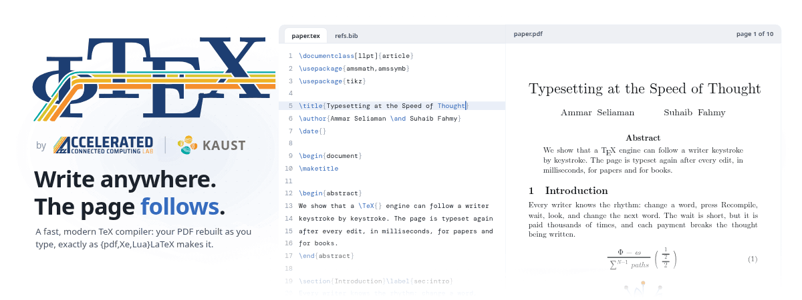</picture>
</p>

<p align="center">
  <b>A fast, modern TeX compiler.</b><br>
  Your PDF rebuilt as you type, exactly as {pdf,Xe,Lua}LaTeX makes it,<br>
  in the editor you already use.
  <!-- TODO(claim): LuaLaTeX is post-alpha; the tagline and the banner GIF's subtitle name it ahead (the user's choice, so the GIF need not change) · Phi -->
</p>

<p align="center">
  <a href="https://phitex.org"><b>phitex.org</b></a> ·
  <a href="#get-started">Get started</a> ·
  <a href="#works-where-you-write">Editors</a> ·
  <a href="#how-it-works">How it works</a>
</p>

<p align="center">
  <a href="https://github.com/accl-kaust/PhiTeX/actions/workflows/checks.yml"></a>
  <a href="https://github.com/accl-kaust/PhiTeX/releases"></a>
  <a href="https://github.com/accl-kaust/PhiTeX/stargazers"></a>
  <a href="LICENSE"></a>
  <!-- TODO(link): the release badge reads "no releases" until the first one -->
</p>

<p align="center">
  <a href="https://chromewebstore.google.com/detail/phitex-instant-for-overle/joimneigjammmhdbgaonlepnlllceajl"></a>
  <a href="https://addons.mozilla.org/en-US/firefox/addon/phitex-for-overleaf-unofficial/"></a>
  <a href="https://microsoftedge.microsoft.com/addons/detail/phitex-instant-for-overle/gkcnpagkdjaefnnpkoogdpacdmgpihpd"></a>
  <a href="https://github.com/accl-kaust/PhiTeX-frontends"></a>
  <!-- TODO(link): the VS Code badge, live once published: https://img.shields.io/visual-studio-marketplace/v/<publisher>.<extension>, linking to its Marketplace page · Phi Frontends -->
</p>

## Why PhiTeX

<table>
<tr>
<td width="33%" valign="top">
<picture><source media="(prefers-color-scheme: dark)" srcset="assets/readme/edit-dark.png">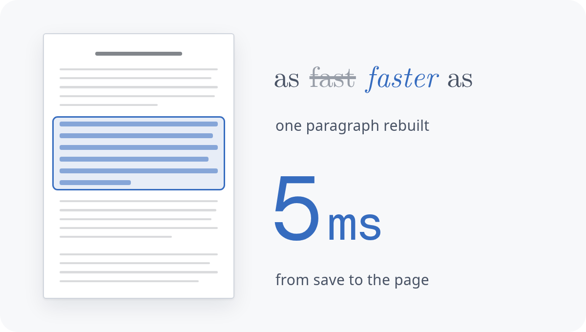</picture><br>
<b>Edits in milliseconds</b><br>
Change a word and only what it touches is rebuilt. A 60-page paper in ⟨~5 ms⟩; a thesis as quick as a letter. <!-- TODO(number): LaTeX word edit, 60 pp and 400 pp, save → page · Phi, mc gate-fast edits (today, an 18-page paper at -j16: pdfLaTeX word edit 46–80 ms, mc 76801; XeLaTeX letter edit 42–50 ms, mc 76836) -->
</td>
<td width="33%" valign="top">
<picture><source media="(prefers-color-scheme: dark)" srcset="assets/readme/exact-dark.png">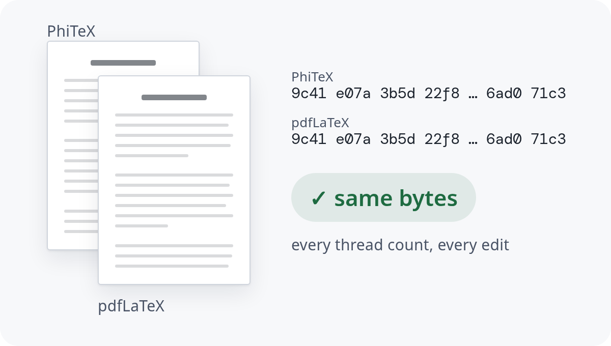</picture><br>
<b>Exactly as {pdf,Xe}LaTeX</b><br>
Byte for byte, cold or after a thousand edits. Nothing changes but the wait. <!-- TODO(claim): XeLaTeX across the corpus (last full sweep 2026-10-28: 83 of 131 identical; fixes since, no fresh sweep) · Phi -->
</td>
<td width="33%" valign="top">
<picture><source media="(prefers-color-scheme: dark)" srcset="assets/readme/editors-dark.png">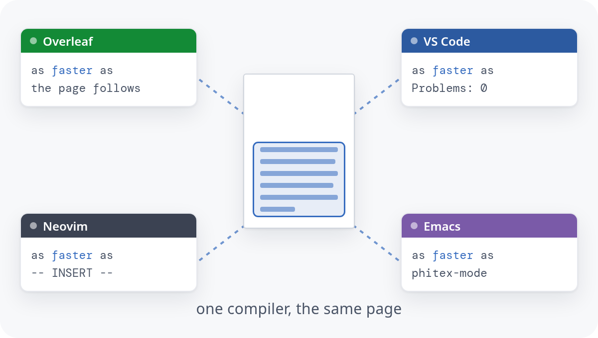</picture><br>
<b>Any editor, Overleaf included</b><br>
Overleaf, VS Code, Neovim, Emacs, any LSP editor, or a browser tab. Double-click the page to reach the source.
</td>
</tr>
<tr>
<td width="33%" valign="top">
<picture><source media="(prefers-color-scheme: dark)" srcset="assets/readme/offline-dark.png">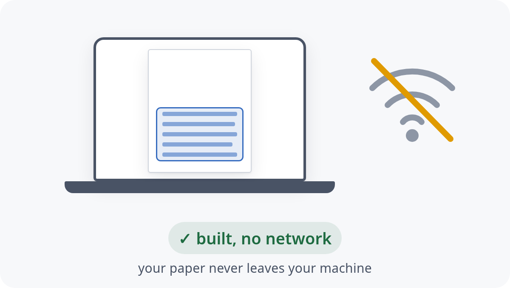</picture><br>
<b>Private and offline</b><br>
Your paper never leaves your machine or your browser. With TeX Live installed, the network is used only to check for updates, and only if you turn that on.
</td>
<td width="33%" valign="top">
<picture><source media="(prefers-color-scheme: dark)" srcset="assets/readme/texlive-dark.png">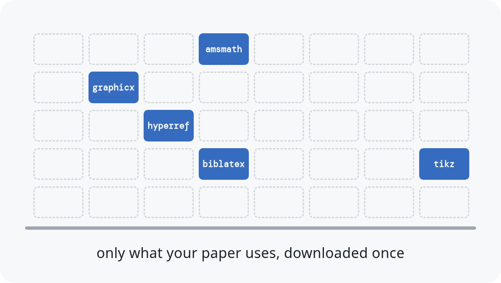</picture><br>
<b>TeX Live optional</b><br>
Without it, each package your paper uses is downloaded once, on first use, and kept.
</td>
<td width="33%" valign="top">
<picture><source media="(prefers-color-scheme: dark)" srcset="assets/readme/cores-dark.png">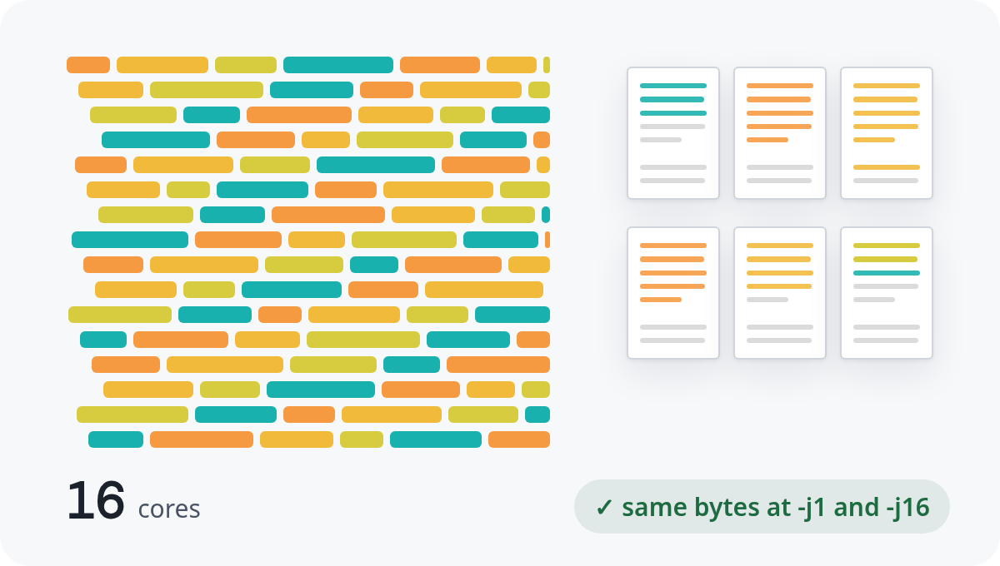</picture><br>
<b>Multi-threaded</b><br>
Paragraphs, pages and the PDF are built in parallel on every core, identical at any thread count.
</td>
</tr>
</table>
<!-- TODO(number): the tiles' figures (5 ms, the hash) come from assets/readme-art.html's FIG; set them from a measured run, then scripts/readme-art.sh -->

Plus: one build does what latexmk does, with BibTeX, biber and makeindex
inside it; errors point at the line; and with `--synctex`, SyncTeX works
with your own PDF viewer, jumping both ways as with pdflatex.

<div align="center">

## Get started

```sh
curl -fsSL https://phitex.org/install.sh | sh
phitex watch paper.tex
```
<!-- TODO(link): install.sh needs the first GitHub release; until then, build from source below -->

`phitex watch` builds your document, opens it live in your browser, and
rebuilds on every save. Double-click the page to jump to the source.

<p align="center">
  <picture><source media="(prefers-color-scheme: dark)" srcset="assets/readme/cli-dark.gif">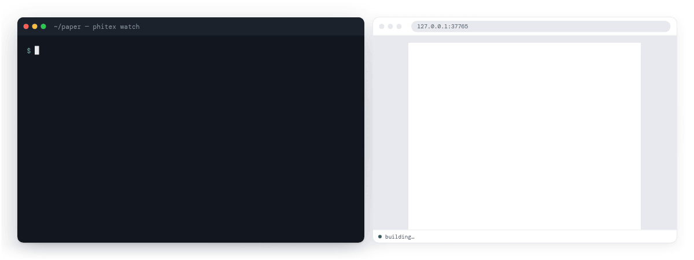</picture>
  <!-- TODO(number): the CLI GIF's figures (assets/cli.html's CONFIG and LIVE) from a real run, then scripts/readme-gifs.sh cli -->
</p>

</div>

One build, start to finish. `\ref`, `\cite`, the table of contents and the
index settle in a single run: no "run it twice", no latexmk. BibTeX, biber
and makeindex run inside the build, and run again only when their input
changes.

```sh
phitex build paper.tex                    # the finished PDF, like latexmk -pdf
phitex watch paper.tex                    # live in the browser, rebuilt on save
phitex --compat=pdflatex paper.tex        # one run, exactly as pdflatex
phitex upgrade                            # the latest release; phitex news says what it brings
```

## Works where you write

<p align="center">
  <picture><source media="(prefers-color-scheme: dark)" srcset="assets/readme/everywhere-dark.gif">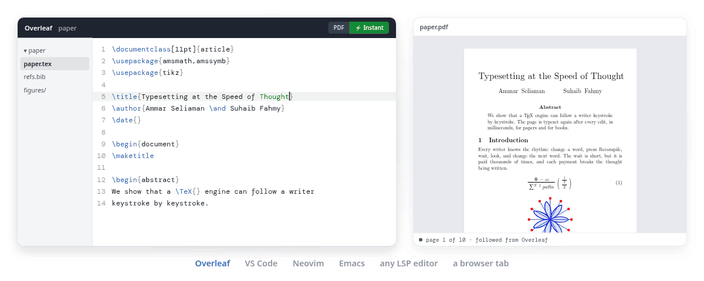</picture>
</p>

| Where | How | Get it |
|---|---|---|
| **Overleaf** | A browser extension adds a **PDF \| ⚡ Instant** switch to Overleaf's toolbar. The page follows your typing. It compiles inside your browser: your document is never sent anywhere. | [Chrome](https://chromewebstore.google.com/detail/phitex-instant-for-overle/joimneigjammmhdbgaonlepnlllceajl) · [Firefox](https://addons.mozilla.org/en-US/firefox/addon/phitex-for-overleaf-unofficial/) · [Edge](https://microsoftedge.microsoft.com/addons/detail/phitex-instant-for-overle/gkcnpagkdjaefnnpkoogdpacdmgpihpd) |
| **VS Code** | A live page beside your editor, errors in the Problems panel, click-to-source both ways. | Marketplace <!-- TODO(link): Marketplace and Open VSX; today from source or a .vsix · Phi Frontends --> |
| **Neovim** | `phitex.lua` (Neovim 0.11+): the page follows your cursor, diagnostics inline. | [editors/nvim](https://github.com/accl-kaust/PhiTeX-frontends/blob/dev/editors/nvim/phitex.lua) <!-- TODO(link): editors/ is on dev only, not main · Phi Frontends --> |
| **Emacs** | `phitex.el` (Emacs 29+): the same, beside eglot or lsp-mode. | [editors/emacs](https://github.com/accl-kaust/PhiTeX-frontends/blob/dev/editors/emacs/phitex.el) |
| **Any LSP editor** | `phitex watch --lsp` is a language server: your buffers are built as you type, problems published, your cursor shown on the page. | built in |
| **Any browser** | `phitex watch` serves the live page at `http://127.0.0.1`. | built in |
| **latexmk, scripts, CI** | Under the name `pdflatex` (or `--compat=pdflatex`), PhiTeX takes pdflatex's command line and makes one run, as pdflatex would. | built in |

The Overleaf extension is unofficial: it is not made or endorsed by
Overleaf. Overleaf's own Recompile stays the PDF you submit.

## Exact

<p align="center">
  <picture><source media="(prefers-color-scheme: dark)" srcset="assets/readme/exact-wide-dark.png">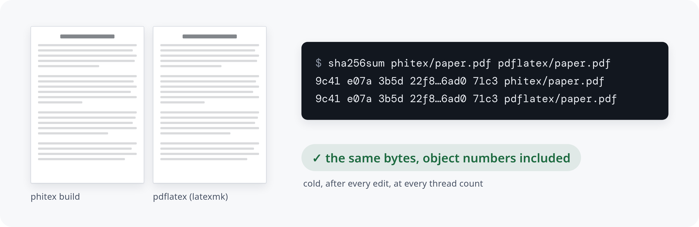</picture>
</p>

"Exact" means the same bytes, not "looks the same". Every PDF PhiTeX writes
is compared byte for byte with pdfTeX 1.40.29's (TeX Live 2026), object
numbers included, and so are the files the job reads back: the `.aux`, the
table of contents, the bibliography. An edit's PDF is always the PDF a
full rebuild would make.

Checked on every change: amsldoc, the LaTeX manual, byte-identical to pdflatex at 1, 8 and 16 threads.
<!-- TODO(number): the corpus size and pass rate for the wider claim · Phi -->

## How it works

<p align="center">
  <picture><source media="(prefers-color-scheme: dark)" srcset="assets/readme/how-dark.png">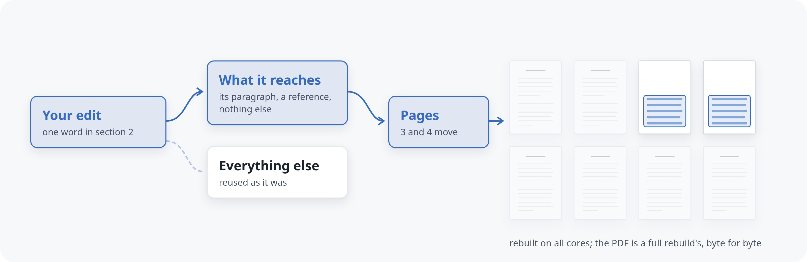</picture>
</p>

A TeX compiler reads your document from the top, every time. PhiTeX
instead keeps the whole build as a graph: each paragraph, each page, each
macro definition and every place it is used. An edit changes one node, and
only what depends on it is rebuilt: the paragraph, the pages it moved, the
references that changed. Everything else is reused, and the work that
remains is spread over your cores.

Underneath, it is a TeX engine in Rust that compiles a document by graph
reduction of pending thunks: macros are functions, the PDF is the root,
and the files a job writes and reads back are a loop reduced to a fixed
point. A cold build is an edit from nothing.

## Status

PhiTeX is in **alpha**.

- **Works:** plain TeX, pdfLaTeX, XeLaTeX and LuaLaTeX, byte-identical;
  BibTeX, biber, makeindex; `phitex watch` and the editors above; Shelf;
  the same engine in WebAssembly with threads; `.synctex.gz`.
<!-- TODO(claim): XeLaTeX byte-identical across the corpus; LuaLaTeX at all · Phi -->
- **Coming:** packages that run external programs, such as
  `minted`, on the command line.
  <!-- TODO(claim): minted unverified natively (works in the Overleaf extension) · Phi -->

What does not work yet, and why, is in [`CHANGELOG.md`](CHANGELOG.md). The
release bars and their measured values are in
[`docs/alpha-checklist.md`](docs/alpha-checklist.md).

## Build from source

```sh
cargo build --release -p phitex-cli   # target/release/phitex
cargo test
```

## Contributing

Contributions are welcome: bug reports, documents that break, fixes, and
new editor integrations.

- **A PDF that differs from pdflatex's is a bug.** Open an issue with the
  smallest `.tex` file that shows it, the command you ran, and
  `phitex --version`. If it builds with pdflatex and not with PhiTeX, that
  is a bug too.
- **Pull requests:** run `cargo test` and `cargo clippy` first. Keep a
  change to one thing, and say in its description what it changes and how
  you checked it.
- **Where things are:** each crate's docs say what it is; the engine's
  design, the crates and the WebAssembly build are described in
  [`CONTRIBUTING.md`](CONTRIBUTING.md).
  <!-- TODO(claim): write CONTRIBUTING.md: move Layout, latexmk compatibility and WebAssembly from the old README there, plus the test corpus and how to compare with pdflatex -->
- **Editors:** the Overleaf and VS Code extensions and the Neovim and
  Emacs plugins live in
  [PhiTeX-frontends](https://github.com/accl-kaust/PhiTeX-frontends).

## Star history

If PhiTeX saves you a wait, a star helps others find it.

<a href="https://star-history.com/#accl-kaust/PhiTeX&Date">
  <picture>
    <source media="(prefers-color-scheme: dark)" srcset="https://api.star-history.com/svg?repos=accl-kaust/PhiTeX&type=Date&theme=dark">
    
  </picture>
</a>

## License

GNU Affero General Public License v3.0 only (`AGPL-3.0-only`); see
[`LICENSE`](LICENSE).

<p align="center">
  Made at <a href="https://accl.kaust.edu.sa">ACCL</a>, <a href="https://www.kaust.edu.sa">KAUST</a>.
  <!-- TODO(link): confirm the ACCL URL -->
</p>
