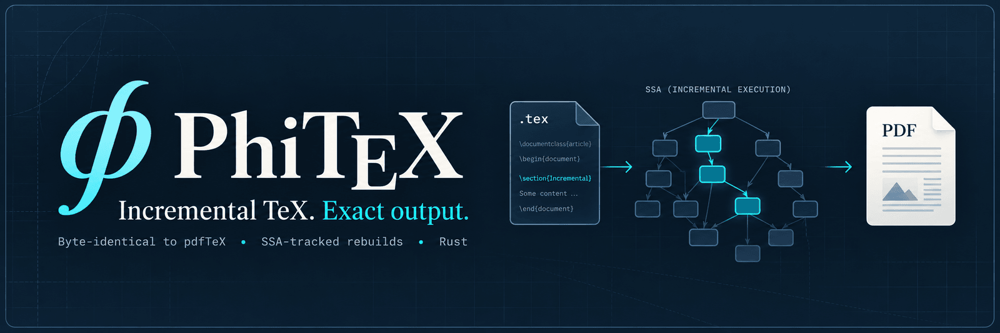

  

  
  
  
  
  
  

# PhiTeX

A TeX engine in Rust that compiles a document by graph reduction of
pending thunks: macros are functions, the PDF is the root, and the files
a job writes and reads back are a loop-back reduced to a fixpoint. A
cold build is an edit from nothing; an edit reduces again only what its
change reaches, and its output is the cold build's, byte for byte.

## Status

- **The engine:** being written as layers: `phitex-defuse` (a TeX-free
  def-use graph of fields) under `phitex-tex` (TeX's semantics on it),
  with `phitex-typeset` (Knuth's algorithms, pure). The PDF is the bar
  (byte-identical with pdfTeX 1.40.29). The previous engine, phitex-red,
  was removed; its pdfTeX oracles are kept under `oracle/fixtures`.
- **The cross-run fixpoint:** the files a job writes (`.aux`, `.toc`,
  `.bbl`, `.ind`) are read back inside the build until they settle,
  BibTeX and makeindex in process.

## Layout

| Crate | What it is |
|---|---|
| `phitex-defuse`, `phitex-tex` | (stubs) the reduction core, TeX on it |
| `phitex-typeset` | Knuth's algorithms as pure functions: line breaking, hyphenation, math, alignments, the page builder |
| `phitex-pdftex`, `phitex-xetex`, `phitex-luatex`, `phitex-lua` | (stubs) the engines, and Lua for LuaTeX |
| `phitex-tfm`, `phitex-dvi`, `phitex-pdf` | (stubs) font metrics, DVI/XDV, pdfTeX's PDF backend |
| `phitex-source` | source text as units with identities; the lexer, paragraphs, syntax tree and the syntactic pass |
| `phitex-cli` | the `phitex` command |
| `phitex-kpse` | kpathsea file lookup |
| `phitex-bibtex`, `phitex-makeindex` | BibTeX and makeindex |
| `phitex-otf`, `phitex-xdvipdfmx` | OpenType shaping, xdvipdfmx |
| `phitex-doc`, `phitex-diff`, `phitex-git` | the document's structure, latexdiff, git |
| `phitex-codecs` | the codecs and PDF reader |

Each crate's docs say what it is; `AGENTS.md` holds the working rules.

## Building

Run every `cargo` command and built binary through `scripts/sandbox`
(bubblewrap: the repo is writable, `$HOME` is empty, and there is no
network unless `--net`):

    scripts/sandbox --net cargo fetch
    scripts/sandbox cargo build --release
    scripts/sandbox cargo test

`scripts/fetch-upstream.sh` fetches the pinned reference sources (TeX Live's
web2c, LaTeX, pgf) into `upstream/`. A TeX Live installation provides the
fonts and packages.

## Use

`phitex` builds a document to its fixpoint (BibTeX and makeindex
included), or watches it and rebuilds as it is edited:

    phitex build paper.tex
    phitex build --output-format dvi paper.tex
    phitex watch -o out paper.tex
    phitex clean paper.tex

Under an engine's name (`pdflatex`, `latex`, `pdftex`, `etex`, `tex`), or
with `--compat=NAME`, it takes that engine's command line and runs once:

    phitex --compat=latex -interaction=batchmode doc.tex
    phitex --compat=pdftex -ini -etex doc.tex

The formats are made on the graph from TeX Live's ini files the first
time they are needed, and cached (`$XDG_CACHE_HOME/phitex`).

XeLaTeX and LuaLaTeX are not supported yet: `--engine xelatex|lualatex`
(or a `% !TEX program` naming them) is an error. PhiTeX never runs an
external TeX compiler.

## License

GNU Affero General Public License v3.0 only (`AGPL-3.0-only`); see `LICENSE`.

This license applies to every revision of this repository, including
those committed before `LICENSE` was added. The `license` field in
earlier revisions of `Cargo.toml` (`MIT OR Apache-2.0`, later
`AGPL-3.0-or-later`) was a placeholder and never licensed this code under
those terms.
